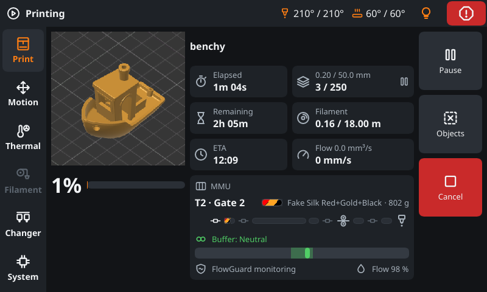
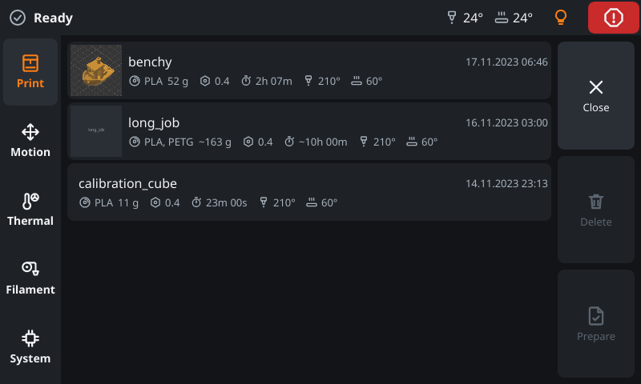
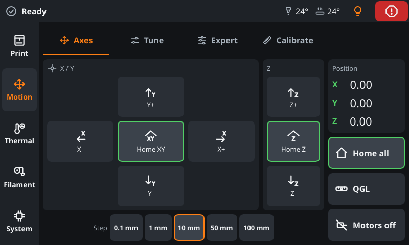
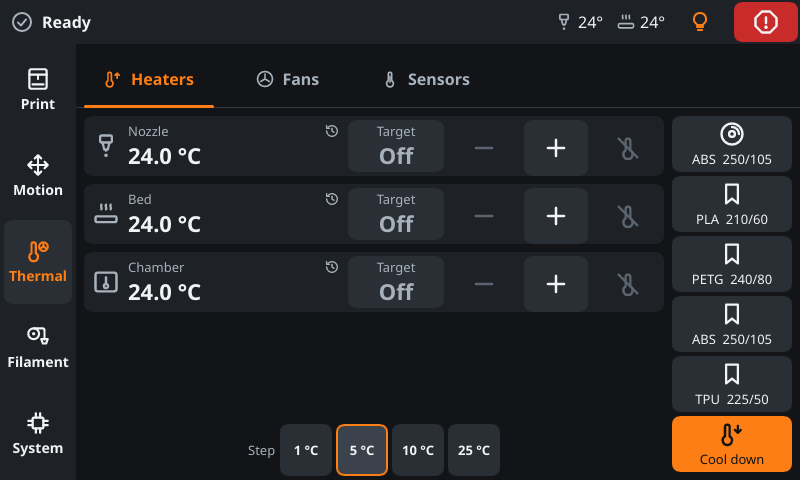
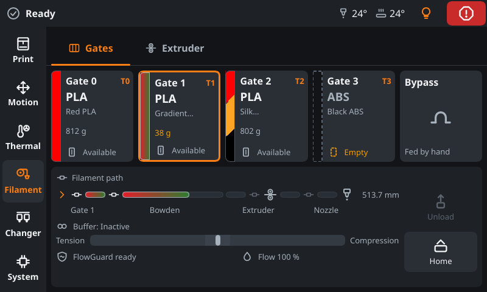
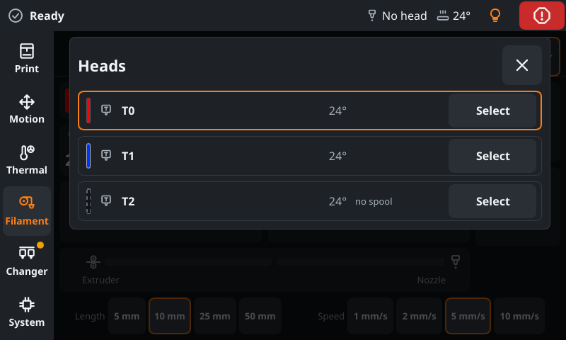
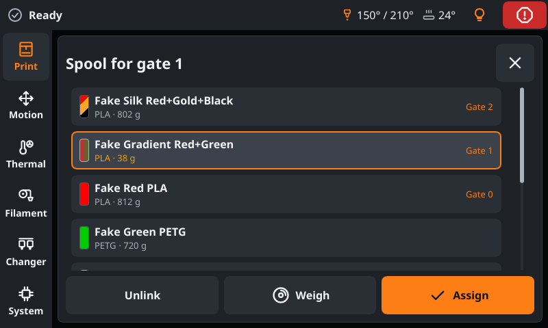

# FreakyMate

**A touch screen for Klipper, with Happy Hare, AFC, tool changers and Spoolman built in.**

FreakyMate is a small native app for the display on your 3D printer. It runs on the printer host (Raspberry Pi, BTT
CB1/CB2 and similar), starts fullscreen at boot and talks to [Klipper](https://www.klipper3d.org/) through
[Moonraker](https://moonraker.readthedocs.io/). Written in Rust with [Slint](https://slint.dev/): no browser, no
desktop needed.



## At a glance

- **Everyday printing:** files with thumbnails, start, pause, cancel, exclude objects, pause at a layer; jog, home,
  level and calibrate; heaters, fans, light, filament, console with macros, updates and Wi-Fi.
- **Multi-material and several heads:** [Happy Hare](https://github.com/moggieuk/Happy-Hare) 4.1 or newer (also with
  several units), [AFC](https://github.com/AFCProject/AFC-Klipper-Add-On) and tool changers with
  [klipper-toolchanger](https://github.com/viesturz/klipper-toolchanger); ERCF, Tradrack, Box Turtle, StealthChanger
  and more, on one Changer page.
- **[Spoolman](https://github.com/Donkie/Spoolman):** the spool in use, a spool picker with weighing, and a hint
  before a print when file and filament differ.
- **Fits your printer:** shows only what your printer has, and points out what looks unusual without forbidding it.
- **Needs:** Klipper with Moonraker on a Debian 12, Raspberry Pi OS Bookworm or Ubuntu 22.04 host (or newer) and a
  display, ideally 5" at 800x480 with touch.
- **Updates** through Moonraker's update manager, like Mainsail and Fluidd. No cloud, no telemetry.

|                                                   |                                                       |                                                         |
| ------------------------------------------------- | ----------------------------------------------------- | ------------------------------------------------------- |
|               |                   |             |
|      |  |  |

More pictures and every page in detail: [Features](docs/features.md). Which plugins and hardware work:
[Requirements and hardware](docs/hardware.md).

> [!IMPORTANT]
> **Young software, tested on a few printers.** My means to test are limited: FreakyMate runs on my own printers and
> on a friend's printer with an ERCF, and it works well there. Tool changers, AFC and Happy Hare with several units
> have been built from the source code of these projects and tried against a simulated printer, not on real
> machines. I am fairly confident that it works well on yours too; if it does not, please
> [tell me](#contact-support-and-donations).
> FreakyMate moves motors, heats and restarts services, so do not leave the printer unattended while you try it. It
> comes without warranty or liability, as far as the law allows (sections 15 and 16 of the [GPL](LICENSE)).

## Install

On the printer host, as the user that runs Klipper and Moonraker:

```bash
curl -fsSLO https://github.com/freakydude/freakymate/releases/latest/download/get-freakymate.sh
bash get-freakymate.sh -m http://127.0.0.1:7125
```

The script picks the build for your system, installs the few packages it needs and sets up a service. FreakyMate then
starts on the display at every boot, and new versions show up in the update list of Mainsail, Fluidd and its own
System page.

Pre-release channel, install by hand, Debian package, desktop window and uninstall: [Install and update](docs/install.md).

## Builds

| Build            | What it is                                                                                    | Where                                                                       |
| ---------------- | --------------------------------------------------------------------------------------------- | --------------------------------------------------------------------------- |
| **Release**      | A tagged state of `main` (`vX.Y.0`), when a set of changes feels finished                     | [Releases](https://github.com/freakydude/freakymate/releases/latest), update channel `stable` |
| **Pre-release**  | Always the latest `main`, replaced by every merged change                                     | [Releases](https://github.com/freakydude/freakymate/releases), update channel `beta` |
| **Pull request** | The state of an open pull request, to try a change before it is merged                        | Artifacts of the pull request's CI run (needs a GitHub login), see [Install](docs/install.md#release-and-pre-release) |

## Documentation

| Page                                          | What it covers                                                                        |
| --------------------------------------------- | ------------------------------------------------------------------------------------- |
| [Requirements and hardware](docs/hardware.md) | Host, display, plugins and typical hardware, what is not supported yet, privacy       |
| [Features](docs/features.md)                  | Every page in detail: print, motion, thermal, filament, changer, system, Spoolman     |
| [Install and update](docs/install.md)         | Release and pre-release, installer, update channels, uninstall, Debian package, desktop |
| [Slicer and macros](docs/printer-setup.md)    | Thumbnails, layers, excluding objects; macros for filament, layer pause and tool spools |
| [Configuration](docs/configuration.md)        | Command line, settings file, log, bug reports, Moonraker login, displays, network     |
| [Troubleshooting](docs/troubleshooting.md)    | Black screen, no connection, touch, where the log is                                  |
| [Development](docs/development.md)            | Build, simulated printer, checks and screenshots, CI and releases                     |
| [Contributing](CONTRIBUTING.md)               | From an idea to a merged pull request                                                 |

## Contact, support and donations

Questions, ideas or a printer to show? Meet me and others who use FreakyMate on Discord. Bugs and feature requests are
welcome as [GitHub issues](https://github.com/freakydude/freakymate/issues/new/choose), pull requests too (see
[Contributing](CONTRIBUTING.md)).

<a href="https://discord.gg/Ja2cxCcmJQ"></a>

FreakyMate is a private project that I work on in my spare time, so answers may take a while. If you like it and want
to say thanks, you can support it here:

<a href="https://ko-fi.com/freakydude"></a>
<a href="https://www.patreon.com/freakydude"></a>
<a href="https://www.buymeacoffee.com/freakydude"></a>

## Made possible by

FreakyMate only shows and controls what other projects do. Thank you to

- [Klipper](https://github.com/Klipper3d/klipper) and [Moonraker](https://github.com/Arksine/moonraker): the firmware
  and the API that FreakyMate talks to, including Moonraker's update manager, which installs its updates.
- [Happy Hare](https://github.com/moggieuk/Happy-Hare) and [AFC](https://github.com/AFCProject/AFC-Klipper-Add-On)
  for multi-material, [klipper-toolchanger](https://github.com/viesturz/klipper-toolchanger) and
  [klipper-toolchanger-easy](https://github.com/jwellman80/klipper-toolchanger-easy) for tool changers,
  [klipper-led_effect](https://github.com/julianschill/klipper-led_effect) for LED effects and
  [Spoolman](https://github.com/Donkie/Spoolman) for keeping track of the spools.
- [Mainsail](https://github.com/mainsail-crew/mainsail) and [Fluidd](https://github.com/fluidd-core/fluidd), whose
  macro conventions (layer pause, spools of tool heads) FreakyMate follows, and
  [KlipperScreen](https://github.com/KlipperScreen/KlipperScreen) with the
  [KlipperScreen Happy Hare Edition](https://github.com/moggieuk/KlipperScreen-Happy-Hare-Edition) for their work on
  running Klipper and Happy Hare from a touch screen.
- [cage](https://github.com/cage-kiosk/cage), the Wayland kiosk that puts FreakyMate fullscreen on the display, and
  NetworkManager for the Wi-Fi settings.
- [Slint](https://slint.dev/) for the UI toolkit, and the Rust crates FreakyMate is built with, among them
  [Tokio](https://tokio.rs/), [reqwest](https://github.com/seanmonstar/reqwest),
  [tokio-tungstenite](https://github.com/snapview/tokio-tungstenite), [serde](https://serde.rs/),
  [image](https://github.com/image-rs/image), [zbus](https://github.com/dbus2/zbus) and
  [clap](https://github.com/clap-rs/clap); the [license](#license) section says where to find all of them.
- [#3DBenchy](https://www.3dbenchy.com/) (CC0) for the boat in the screenshots.

## License

GPL-3.0-or-later, see [LICENSE](LICENSE). Slint is used under its GPLv3 option. The packages list the licenses of
all dependencies in `THIRD-PARTY-LICENSES.html`.

- **Use is free for everyone**, companies included, for example on your own printers or in a print farm.
- **Building FreakyMate into a product** (preinstalled on printers, displays or kits) is possible under the GPL's
  conditions. If they do not fit your plans, I am open to a commercial license: see [COMMERCIAL.md](COMMERCIAL.md).
- **Name and logo** are not covered by the GPL; forks and products need their own name, see
  [TRADEMARKS.md](TRADEMARKS.md).
