# Features

What each page of FreakyMate does. Functions only appear when the printer has them (capabilities from
`printer.objects.list` and `server.info`). Configuration sections whose name starts with `_` are helpers and not
shown, as in Mainsail: macros, heaters, temperature sensors, fans, LEDs, LED effects and filament sensors (a hidden
probe still counts as the probe).

- **Print**: thumbnail, progress, elapsed/remaining/ETA, layers with current and object height, filament; start, pause, resume, cancel, pause at a layer (planned pause shown), exclude objects (on a map of the bed if the slicer defines their outlines);
  file browser with thumbnails, filament (material of each tool), nozzle and print time of each file.
  - **Prepare**: a tap on a file marks it; with one file marked, **Prepare** makes it the job of the print page and
    **Delete** removes it (with several marked, only **Delete**, which names the files first). Preparing happens only
    in FreakyMate: Moonraker and other clients notice nothing, and after a restart the print page shows Klipper's current
    file again. The page then shows the file's estimated time, filament, nozzle diameter and temperatures, and what each
    tool asks of the filament. A print that starts, from anywhere, takes the place of the prepared file; a prepared file
    that is deleted is dropped. **Print** asks for confirmation as before.
  - **Filament check per tool**: the file's colour, material and weight for each tool, against the filament where that
    tool prints from (with Happy Hare the gate of the tool, otherwise the active spool; only what both sides know is
    compared). The result is a hint on the print page (for example "2 of 3 tools match", a tap leads to Filament →
    Tools), in the tool list and in the gate picker; it never blocks a print or a change. A clear filament (colour with
    full transparency) is not compared by colour.
    Each tool chip on the print page also shows the material the file asks for, in the warning colour when the gate
    holds another. A tap on a tool opens a comparison: material, colour, weight and name of the file against the
    gate, differing values in the warning colour, the slicer's estimate with `~`. FreakyMate does not know why they
    differ (wrong filament, or only the gate map or the spool in Spoolman), so it gives no instructions, only buttons
    for what can be done: open the gate, change its spool, choose another gate (a tick marks gates whose data fit).
    A tool the printer does not have (no gate mapped by Happy Hare, or without Happy Hare no command `T<n>`) shows as
    "No gate". Tools that share a gate share its spool, so their planned weights add up against what the spool has
    left; with EndlessSpool the rest of its group is shown as its own line. The question before the start shows the
    same comparison, compact, for each tool that does not fit.
- **Motion**: the **Axes** tab jogs X/Y/Z with selectable steps, homes (all/XY/Z), turns motors off, runs Quad Gantry Level
  or Z-Tilt when configured. Filament is locked while a print runs and the screen leaves it when a print starts; on
  Motion the Axes and Calibrate tabs are greyed out then and the page shows the Tune tab.
  - **Calibrate** tab: Klipper's own calibration commands, with their results. Bed screws
    (`SCREWS_TILT_CALCULATE` with the turns per screw, or the paper test `BED_SCREWS_ADJUST`), Z offset of the probe or
    the Z endstop, bed mesh (measure, a coloured map of the active mesh, load, save and remove profiles, clear) and
    what `SAVE_CONFIG` would write. While Klipper waits for the paper test or the Z height, a dialog shows its steps;
    closing it aborts. FreakyMate only starts these commands, Klipper does the work.
- **Thermal**: every heater with a target (nozzle, bed, `heater_generic`, `temperature_fan`), presets; − and +
  respect `min_temp`/`max_temp` from the Klipper configuration. Tapping a heater or sensor shows its temperature
  history with a grid: the last 20 minutes of Moonraker's temperature store, asked again every five seconds while it
  is open. Moonraker keeps heaters and `temperature_sensor` objects there; the others have no history. Further tabs when the printer has them:
  - **Fans**: part fan (the one of the nozzle in use first) and `fan_generic` fans (filter, exhaust) with a slider, `heater_fan` and `controller_fan` as a
    bar, speed in rpm where there is a tachometer. A fan turns red when its tachometer has reported 0 rpm for a few
    seconds at a speed where it measured before (many tachometers report nothing at a low speed although the fan
    turns); what it learned is forgotten when Klipper restarts.
  - **Sensors**: every temperature without a target (`temperature_sensor` of any sensor type, TMC2240 drivers).
- **Light**: the light symbol in the status bar opens a panel with the main (chamber) light as a switch, every LED
  (`neopixel`, `led`, `dotstar`, …) on, off and dimmed as white light, and the effects of the
  [led_effect](https://github.com/julianschill/klipper-led_effect) plugin when it is installed.
- **Tune** tab of Motion: what one corrects while watching a print: Z offset (babysteps, apply to probe/endstop, save config) and
  the speed factor, with a quiet note that layer times then differ from the slicer's plan. The **Expert** tab holds
  the calibration values until the next restart: flow factor, pressure advance and smooth time, velocity and
  acceleration limits, square corner velocity, minimum cruise ratio and firmware retraction; it shows where a value
  differs from the configuration and resets it.
- **Filament**: filament colours with transparency are drawn over a checkerboard, so a clear or translucent filament reads as see-through; extrude/retract with length and speed (lengths up to `max_extrude_only_distance`), `LOAD_FILAMENT`/`UNLOAD_FILAMENT` macros when present, filament sensors (with Happy Hare those it does not show itself).
- **System**, in five tabs:
  - **Machine**: Klipper/firmware restart, host reboot/shutdown, service restart, power devices.
  - **Updates**: Moonraker's update manager; the tab shows how many updates are waiting.
  - **Network**: Wi-Fi and Ethernet (see [Network settings](configuration.md#network-settings)).
  - **Console** (also from the message flyout): G-code history and live responses, a command field (on-screen keyboard
    or physical keyboard), and an expandable list of macros. Like Mainsail it hides the temperature reports Klipper
    sends while waiting for a heater (the thermometer button next to the command field shows them). Macros starting
    with `_` and macros that rename a built-in command (`rename_existing`) are left out; **Edit** in the macro list
    switches further macros off and on. Macros with parameters
    open a form first: each parameter is read from the macro's template, Klipper defaults show as placeholders in
    brackets.
  - **Settings**: Moonraker address and login (see [Moonraker login](configuration.md#moonraker-login)), fullscreen,
    and when the screen goes off by itself (see [Brightness and standby](configuration.md#brightness-and-standby)).
    Temperature presets are set in the [settings file](configuration.md#settings-file).

| 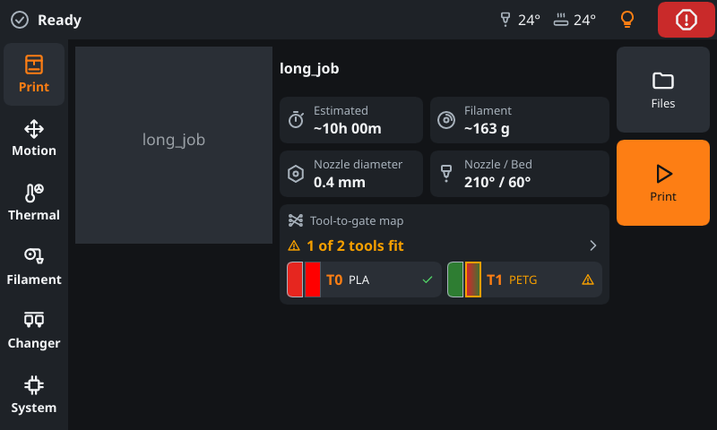 | 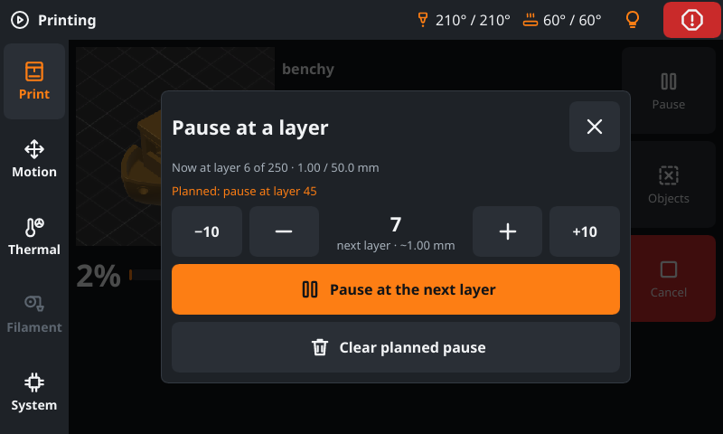            |
| -------------------------------------------------------------------- | ----------------------------------------------------------- |
| A prepared file with the filament check per tool                     | Pause at a layer, with the pause planned for layer 45       |
| 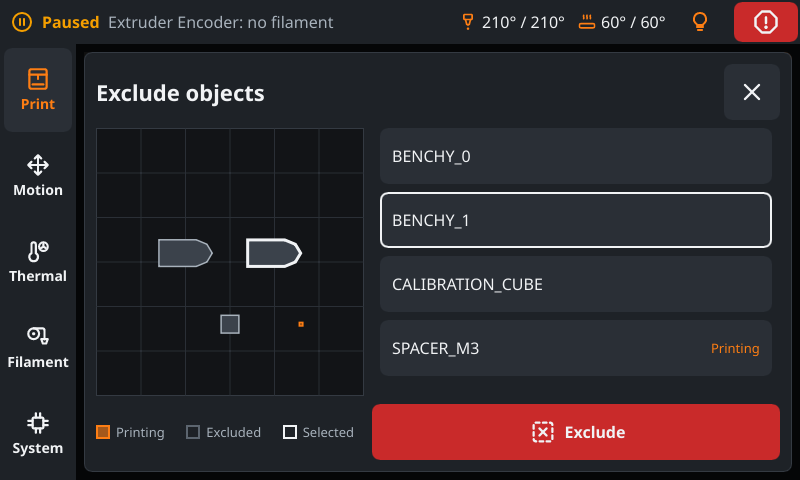       | 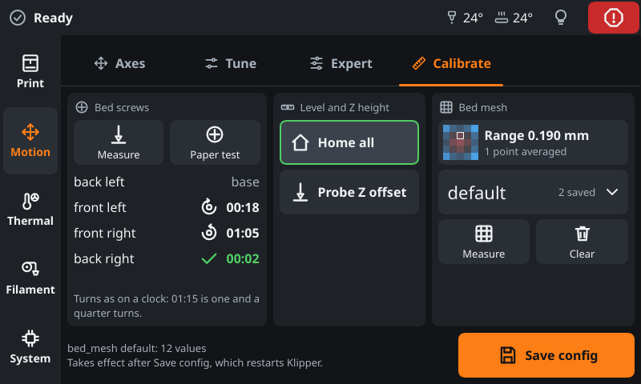                 |
| Exclude objects: the bed map with the outlines from the slicer       | The Calibrate tab: bed screws, Z height and the bed mesh    |
| 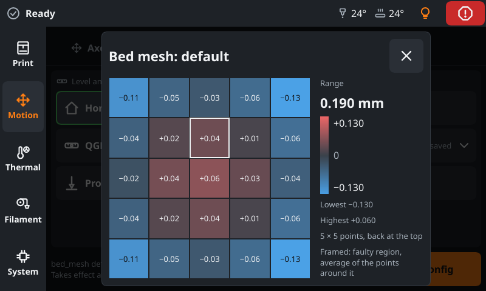                   |                                                                       |
| The map of the active bed mesh, with a faulty region framed |                                                                       |

## Happy Hare (MMU)

Needs Happy Hare 4.1 or newer. The Filament page then opens on the **Gates** tab, next to **Extruder**; the **Changer** page
holds **Tools** and **Service**. The Gates tab and a strip on the print page show:

- the gates and the bypass (five at a time): status, material, colour and the tools that take their filament from each
  gate; unload what is loaded, home, recover and unlock after a pause;
- the way of the filament of the selected gate, from the gate through the bowden and the extruder to the nozzle,
  filled in the colours of the spool as far as Happy Hare reports it (`filament_pos`), with the sensors on the way,
  the direction and the distance; on the print page as a slim line;
- the other MMU sensors, the sync-feedback buffer (tension, neutral, compression) and the FlowGuard state: ready, monitoring,
  tangle prevention at work, or triggered with its reason;
- the flow rate, measured by the encoder or estimated by the sync-feedback controller with a proportional sensor.

A tap on a gate opens what can be done with it: select, load, preload, check or eject it, and pick its spool. Without
Spoolman the dialog sets material and colour of the gate in Happy Hare's gate map instead, from a set of common
materials and colours. A tap on a gate never moves the selector by itself. The bypass takes filament fed by hand past
the gates; its dialog selects and loads it. **Changer > Tools** is the one place to set which gate each tool takes its
filament from (Happy Hare's tool-to-gate map): one row per tool with what its gate holds (material, colour, spool, grams
left and, with EndlessSpool, what its group can still give), and a tap on a tool offers the gates with their colour and
material. With a file prepared (or the file of the current job), each row shows on its left what the file asks of the
tool and whether the gate fits (✓ or ⚠, a hint only); only what differs is yellow: the material, the colour as a frame,
the weight. A multi-colour spool is compared by its first colour, since slicers know one colour per tool. The gate list
marks the gates that fit. The tab also resets the map; its EndlessSpool dialog turns EndlessSpool on or off and moves
each gate from group to group.
The **Service** tab holds what is rarely needed for the MMU as a whole: home, recover, unlock, motors off, check all
gates and, on selectors with a servo, servo up and down.

| 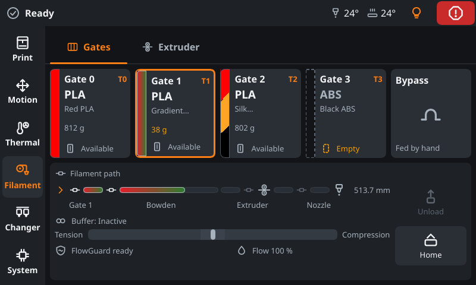                                    | 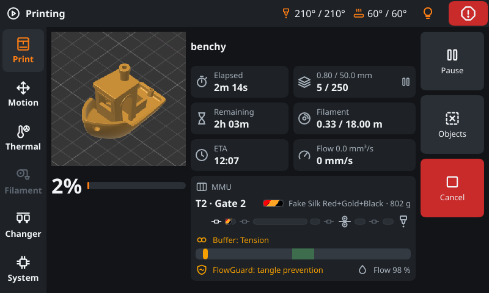 |
| -------------------------------------------------------------------- | ----------------------------------------------------------------------------------------------------- |
| The Gates tab: gates, sensors, buffer                                | The print page while tangle prevention raises the gear current (the FlowGuard line turns yellow)      |
| 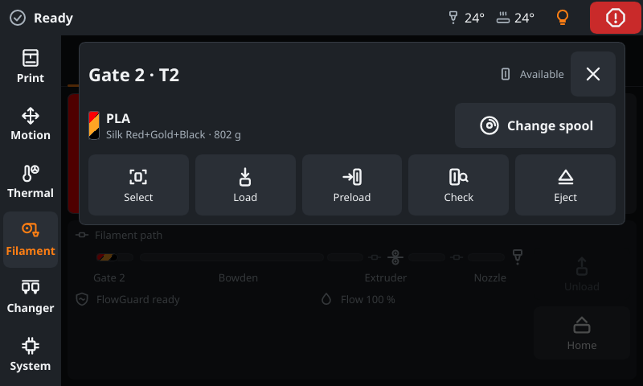                          | 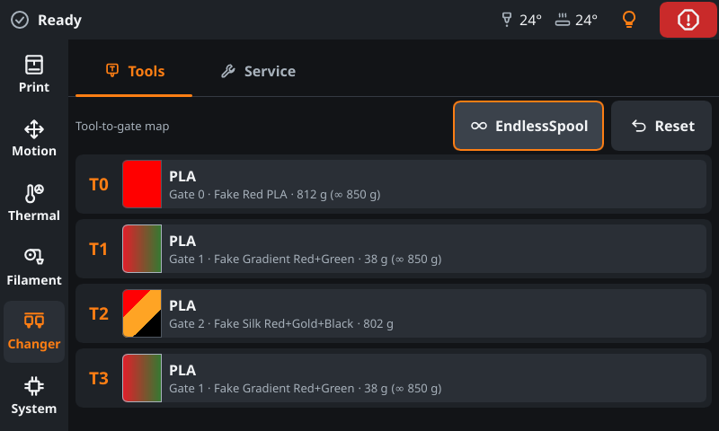                                                               |
| A tap on a gate: select, load, preload, check, eject, pick its spool | Changer > Tools: T3 moved to gate 1, what each gate holds, EndlessSpool on                              |

**Quieter console (recommended).** FreakyMate shows Klipper's console messages in its status bar. Happy Hare prints a
lot there by default: the gate table at startup, a picture of the filament path and statistics after every tool
change. FreakyMate draws the gates and the filament path itself from `printer.mmu`, so these lines only crowd the
status bar.
Happy Hare can keep the console to the essentials and still write everything to `mmu.log`; in `mmu_parameters.cfg`:

```ini
log_level: 0            # console: essential messages and errors only
log_file_level: 2       # mmu.log keeps the details (debug)
log_visual: 0           # no filament path picture in the console
log_startup_status: 0   # no gate table at startup
log_statistics: 0       # no statistics after each tool change (still recorded)
```

This changes the console for every client, Mainsail and Fluidd included.

**Several units** (Happy Hare v4, for example an ERCF and a Tradrack on one printer): the Gates tab shows one page per
unit, with a caption naming the unit, the head it feeds when there are several, and the page within the unit. It
opens on the unit of the loaded gate. Each unit's bypass is its last tile.

## Changer

The **Changer** entry in the navigation appears when the printer has a filament changer (Happy Hare, AFC) or a tool
changer. It holds the machine as a whole; the everyday work with one head stays on the Filament page. Its tabs only
appear where they have content:

- **Tools**: which lane or gate each tool takes its filament from (Happy Hare's tool-to-gate map, AFC's lane map),
  with EndlessSpool for Happy Hare. A tool changer alone has no Tools tab, since its `T<n>` is the head.
- **Service**: the rarely needed commands of each changer, with its state first, so the reason for a disabled
  command is visible above it.
- **Sensors**: filament sensors that belong to no head, on printers with a tool changer. A dot on the tab and on the
  Changer entry shows a switched-on sensor without filament.

## AFC

With [AFC](https://github.com/AFCProject/AFC-Klipper-Add-On) (Box Turtle, Night Owl and other units) the Filament page
shows its lanes as tiles on the Gates tab, one page per unit, with the same dialog as a Happy Hare gate: load, unload,
eject, pick the spool, or set material and colour. Below the tiles a card shows the way of the filament of the
selected lane through its unit and the hub to the head.

- **Changer › Tools** maps tools to lanes (`SET_MAP`) and resets the map.
- **Changer › Service** shows AFC's state, **Clear error** while AFC reports an error (also in the tab row of the
  Filament page), and **Back to hub** per lane, which pulls a lane's filament back to the hub. It is offered only
  for lanes with filament and a hub, not while printing, and is locked while a lane is loaded in the head or the hub
  is already clear.
- AFC's own tool changer (`AFC_Toolchanger`, for example the Snapmaker U1) shows its heads as below.

## Tool changers

With [klipper-toolchanger](https://github.com/viesturz/klipper-toolchanger) or
[klipper-toolchanger-easy](https://github.com/jwellman80/klipper-toolchanger-easy) (StealthChanger, TapChanger and
others) the Filament page shows one head at a time:

- A **head chip** at the top right shows the head in view: the colour of its spool, `T<n>`, its nozzle temperature
  and a check when the changer detects it on the carriage. A tap opens the **head list**: every head with its spool,
  temperature and state, and one button: on a head that is not mounted **Select** (`T<n>`), or **Pick up** for a head
  with several lanes; on the mounted head **Drop**, where the changer offers `UNSELECT_TOOL`. The buttons are locked
  during a print and while the changer is not ready. Tapping a row only
  shows that head; it never moves the printer.
- A **hint line** appears only when something is off: the changer is not initialized and will not do so by itself
  (with **Initialize**; not with `initialize_on: first-use`), reports an error (with **Recover**), or, while ready, the
  selected and the detected head differ.
- **Changer › Service** shows the changer's state, the selected and the detected head, with Initialize and Recover
  (Recover asks first).
- The status bar shows the nozzle of the selected head, presets heat it, and Thermal › Fans lists the part fan of the
  mounted head first.
- **Spools per head** follow the convention of Fluidd and Mainsail (`spool_id` on `T<n>`), see
  [Spools of tool heads](printer-setup.md#spools-of-tool-heads).
- **With an MMU per head** (Happy Hare units or AFC lanes that feed different extruders) each head shows the gates of
  its own unit.

| 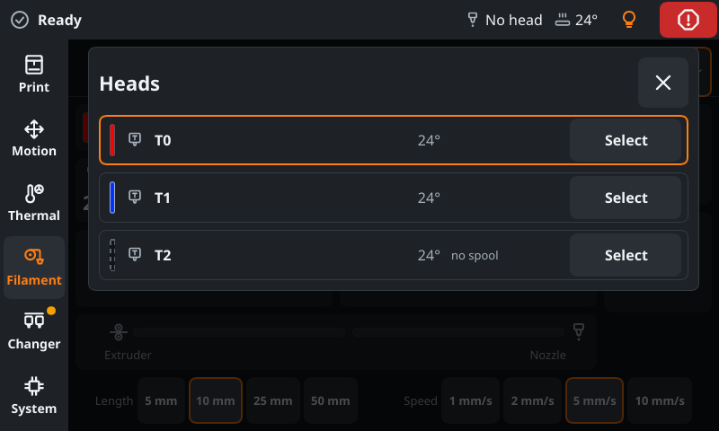 | 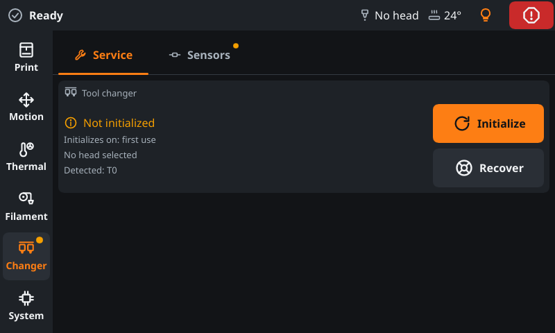 |
| ----------------------------------------------------------------- | ----------------------------------------------------------------------------------- |
| The head list: select, pick up or drop a head                     | Changer › Service: state of the tool changer, Initialize and Recover                |
| 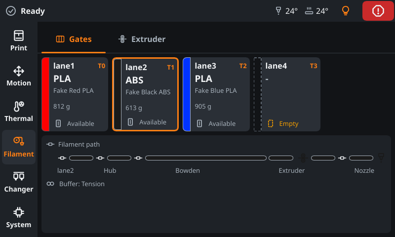                           | 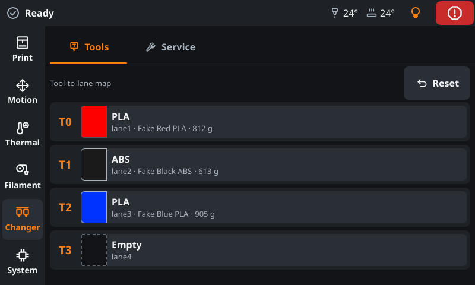                      |
| The lanes of a Box Turtle (AFC) with the load path                | Changer › Tools: which lane each tool takes its filament from                       |
| 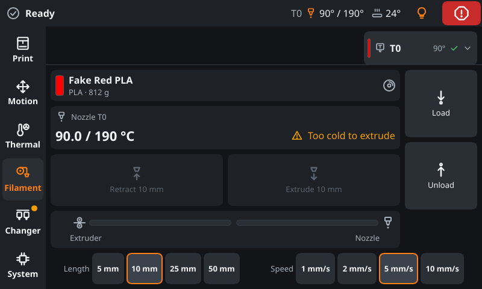  | 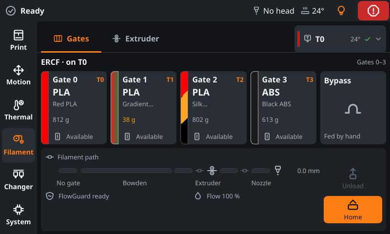                     |
| The Filament page of the mounted head, with the head chip         | A tool changer with an MMU per head: the gates of the ERCF on T0                    |

## Spoolman

Appears when Moonraker has the `spoolman` component, with or without an MMU:

- the spool in use and what is left of it on the print page and at each gate, with a colour bar for multi-colour
  filaments: side by side for coaxial ones (silk), taking turns for longitudinal ones (gradient); on Changer > Tools a
  colour field split diagonally for coaxial ones and blending for longitudinal ones (up to six colours, a rainbow);
- a picker lists the spools (the ones in a gate first, then the most recently used): assign a spool to a gate or, without
  an MMU, choose the active spool, and correct the remaining weight by weighing;
- a filament colour with transparency (alpha) shows over a checkerboard in the gate bars, dialogs and Changer > Tools;
- the temperature page offers a preset for the spool in use and notes quietly when the target is off from it;
- before a print the confirmation names what differs between the file and the spools (material, weight, colour), only as
  a hint.

| 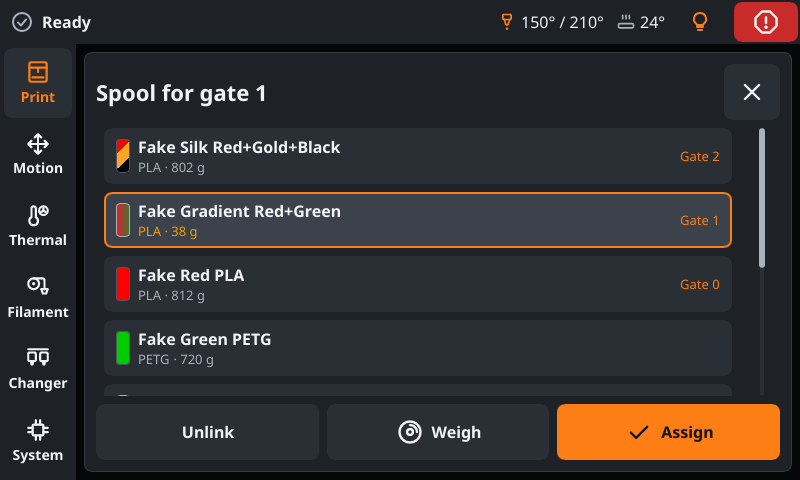 | 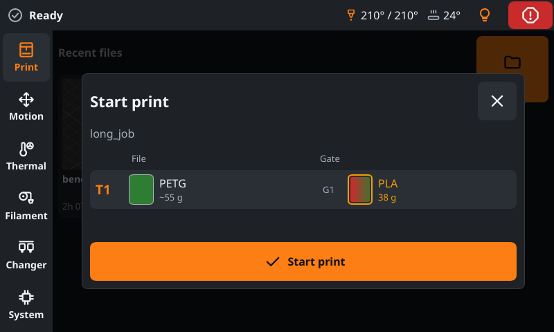 | 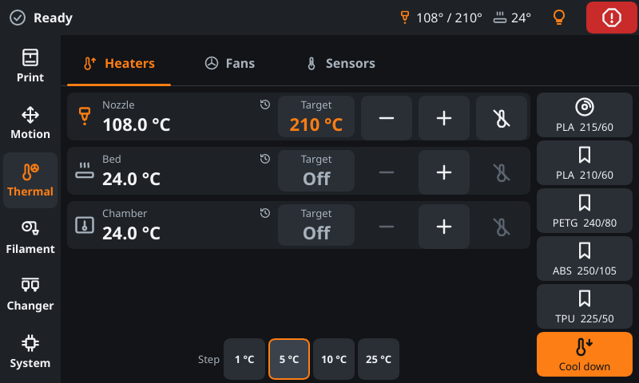 |
| --------------------------------------------- | ------------------------------------------------------ | -------------------------------------------------------------------------- |
| Spools with colour, material and weight left  | Before a print: what differs between file and spools   | The first preset on the temperature page belongs to the spool in use       |
