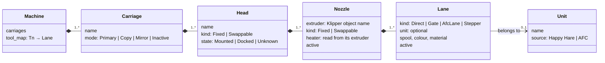
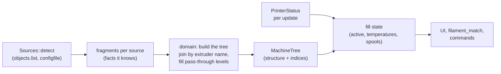

# Multi-tool printers (design draft)

Draft, 2026-11-10. Nothing of this is implemented yet. Object and field names were read from the sources' code
(main branches of that day), see [What each source reports](#what-each-source-reports).

## Goal

A printer can bring more than one filament to the bed in many ways: a filament changer (MMU) in front of one
extruder, several extruders into one nozzle, two nozzles on one head, heads to swap (tool changer), nozzles
to swap under one fixed head (Bondtech INDX), several carriages (IDEX), and combinations of these. FreakyMate shows and controls all of them with **one model**: a tree
that is assembled from what the detection finds. Screens, hints before a print (`filament_match`) and commands work
against the tree only and never ask which plugin is behind it.

Principles:

- **Every level is optional.** A level that the printer does not have is a pass-through: exactly one implicit node,
  never shown. A printer with one extruder and no MMU is a tree with one path and looks as it does today.
- **Every level can come in variants.** A head is fixed or swappable, a lane is a gate, an AFC lane, an extra
  extruder stepper or the direct feed. Variants are data on the node, not separate code paths in the UI.
- **Built from evidence.** Only what a source reports or the configuration states goes into the tree. Macros stay
  black boxes. Where a link cannot be detected, the tree leaves it open rather than guessing.
- **Built once, filled often.** The structure only changes with a Klipper restart, so it is assembled once at
  detection. Each status update only fills in the state (active, temperatures, spools) through indices prepared
  then.
- **Hand configuration last.** FreakyMate settings or FreakyMate macros that describe the machine are the last
  resort, or a way to individualise (experiments, new projects, special wishes); see
  [Overrides](#overrides-the-last-resort).

## The tree

From the bed inwards: a printer has carriages, a carriage holds heads, a head has nozzles, a nozzle is fed by lanes.



| Level    | Several of them when                                                       | Pass-through otherwise |
| -------- | -------------------------------------------------------------------------- | ---------------------- |
| Carriage | `dual_carriage` (IDEX; with `generic_cartesian` also more than two)        | one carriage           |
| Head     | a tool changer: `toolchanger` + `tool <name>`, `ktc` + `ktc_tool <name>`, AFC with an `AFC_Toolchanger` unit | one fixed head |
| Nozzle   | more than one Klipper `extruder*` object (each has its own heater), or swappable nozzles under one extruder (INDX) | `extruder` |
| Lane     | a filament changer (Happy Hare gates, AFC lanes) or extra `extruder_stepper`s feeding one nozzle | the direct feed |

**Where the swap happens is a property, not a level.** A tool changer swaps whole heads, each with its own
extruder. Bondtech INDX keeps one fixed head with the only extruder (motor, induction heater, IR sensor) and swaps
passive tools under it, each just a nozzle with its own filament path: one Klipper `extruder`, several nozzles, one
lane each. A filament changer swaps lanes. So any level can be swappable (`Mounted`/`Docked`), and a nozzle is the
physical outlet: usually one per Klipper extruder, with INDX several sharing it, of which one is mounted.

**Why the unit is not a level.** A Happy Hare v4 unit feeds one extruder, but an AFC unit (a Box Turtle, say) can
spread its lanes over several extruders. So the unit is a label on the lane (for grouping on screen and for its own
state such as the buffer), not a node between nozzle and lane.

**The Klipper extruder is the joint.** Not the nozzle: with INDX several nozzles share one extruder. Heater and
temperature belong to the extruder, the nozzle refers to it. Every source names the Klipper extruder it means,
though not always in its status:

- the tool changer's `tool <name>` reports `extruder`;
- KTC's `ktc_tool <name>` reports `heater_names` (an extruder's heater carries the extruder's name);
- a Happy Hare v4 unit has `extruder_name` in its configuration (`mmu_unit <name>`), and Happy Hare creates one
  object `mmu_extruder <extruder name>` per extruder it feeds; its status only names the extruder of the selected
  unit;
- an AFC lane reports its `extruder` (an `AFC_extruder` section), whose configuration names the Klipper extruder
  (`extruder_name`, default its own name);
- an `extruder_stepper` reports `motion_queue`, the extruder it is synced to right now.

Klipper's extruder object name is therefore the key that joins the fragments of different sources into one tree.
Since the structure is built once from `printer.objects.list` and `configfile.settings`, links that only the
configuration holds are fine. The one link nothing reports is which nozzle sits on which IDEX carriage (see
[open questions](#open-questions)).

## Slicer tools are a map, not a level

`Tn` from the slicer is logical: it says which filament, not where it comes from. Each source that knows the answer
contributes a map `Tn → lane`:

| Setup                         | Map comes from                                                        |
| ----------------------------- | --------------------------------------------------------------------- |
| Happy Hare                    | the tool-to-gate map (`mmu.ttg_map`), gates numbered across all units |
| AFC                           | each lane's `map` (`"T4"`); a tool changer's heads appear as lanes too |
| Tool changer without MMU      | the tool number of each head (`tool.tool_number`, KTC `ktc_tool.number`) → its one lane |
| INDX                          | `Tn` → passive tool n, each with its own lane                          |
| Several extruders, no changer | by convention `Tn` → `extruder`, `extruder1`, … in order (the macros `T0`… exist) |
| One extruder, no MMU          | `T0` → the only lane                                                   |

In the code `tool` already means `Tn` (`Lane::tool`, `ToolRequest::tool`); the physical tool is therefore called
**head** here, to keep the two apart.

Several sources can claim the same `Tn` (a tool changer numbers its heads, and a filament changer on one of them
maps tools to its gates). The deepest source that maps to a lane wins: the filament changer's map beats the tool
changer's numbers, which beat the convention. The code supports this: Happy Hare's `Tn` looks up `ttg_map`, selects
the gate and with it the unit, and never calls a tool changer or `ACTIVATE_EXTRUDER`; the swap of the head is left
to the user's macros. AFC's `Tn` picks the lane and, for a head, calls the tool changer itself.

## Active state

Each level has its own "active", read from the source that knows it:

- Carriage: the mode in `dual_carriage` (`carriage_0`/`carriage_1`, or `carriages` with `generic_cartesian`).
- Head: `toolchanger.tool` / `tool_number` (-1: none), KTC `ktc.active_tool_n` (-1 none, -2 unknown). AFC has no
  key for it; its loaded lane and `toolhead.extruder` say the same. Where tools have detection pins,
  `toolchanger.detected_tool` tells which head is really mounted.
- Nozzle: `toolhead.extruder`; with swappable nozzles under one extruder (INDX) the mounted one from the tool macro
  convention (`T<n>.active`).
- Lane: Happy Hare `mmu.gate`, AFC `AFC.current_load` (a lane name); with one lane, that lane.

The active path is the chain of active nodes. IDEX in copy or mirror mode is the one case with **two active
paths** at once; screens and hints must allow that (a list of active lanes, not one).

## Assembly



- Each source module contributes a **fragment** at detection: the nodes and links it knows, keyed by Klipper names
  (`klipper/`: nozzles, `extruder_stepper`s, carriages; `happy_hare/`: units and gates with their extruder;
  `afc/` (new): units, lanes, maybe heads; `toolchanger/` (new, covers viesturz and KTC-easy): heads with their
  extruder; `ktc/` (new, if worth it).
- `domain/machine_tree.rs` (new) joins the fragments: nodes that name the same extruder attach to it (one nozzle as a rule,
  several swappable nozzles with INDX), missing
  levels become pass-through nodes, the `Tn` map is chosen by the rule above. It knows no plugin, only fragments.
- The tree keeps, per node, where its state lives (object name and field), so filling it per update is a walk over
  prepared indices without searching by name.
- `domain/spools.rs` keeps `Lane` and gets its parent nozzle; `lanes()` becomes the lanes of the tree.
  `filament_match` compares `Tn` through the map; temperatures are compared at the extruder of the lane's nozzle.

## What each source reports

The fields a fragment needs; the full lists are in each project's `get_status()`.

| Source | Objects | Structure (read once) | State (per update) |
| --- | --- | --- | --- |
| Klipper | `toolhead`, `extruder*`, `extruder_stepper <name>`, `dual_carriage` | the extruders; the carriages | `toolhead.extruder`; per extruder `temperature`, `target`; `extruder_stepper.motion_queue`; carriage modes |
| Tool changer ([viesturz], [KTC-easy]) | `toolchanger`, `tool <name>` | `tool_names`, `tool_numbers`; per tool `tool_number`, `extruder`, `fan`, `gcode_*_offset` | `status` (`ready`, `changing`, `error`, …), `tool`, `tool_number`, `detected_tool`; viesturz only: per tool `detect_state` (`mounted`, `absent`, `unavailable`) and `heater` |
| KTC ([TypQxQ]) | `ktc`, `ktc_tool <name>`, `ktc_toolchanger <name>` | `tools`; per tool `number`, `heater_names`, `offset` | `active_tool`, `active_tool_n`, `state`; per tool `state`, `heater_state` |
| Happy Hare v4 | `mmu`, `mmu_machine`, `mmu_extruder <name>` | `mmu_machine.num_units`, `unit_<n>` with `name`, `first_gate`, `num_gates`, `display_name`; extruder per unit from `configfile` (`mmu_unit <name>`: `extruder_name`, default `extruder`) | `mmu.unit`, `tool`, `gate`, `ttg_map`, the `gate_*` arrays (across all units), `filament`, `print_state` |
| AFC | `AFC`, `AFC_lane <name>` / `AFC_stepper <name>`, `AFC_extruder <name>`, units such as `AFC_BoxTurtle <name>`, `AFC_Toolchanger <name>` | `AFC.lanes`; per lane `unit`, `extruder` (the `AFC_extruder`), `map`; per `AFC_extruder` from `configfile` the Klipper extruder (`extruder_name`, default its own name) and `toolchanger_unit` (a head of AFC's tool changer) | `AFC.current_load`, `current_state`; per lane `status`, `tool_loaded`, `spool_id`, `color`, `material`; per `AFC_extruder` `lane_loaded`, `on_shuttle`, `status` |

Setups built from macros only (INDX under Klipper, IDEX, several extruders) often follow the convention that
Fluidd's tool buttons read: macros `T0` … `Tn` with the variables `active` and `color` (Fluidd
`ToolChangeCommands.vue`; Mainsail reads neither). INDX sets them from its own state (`save_variables`:
`active_tool`, offsets), see
[indx-tc-macros.cfg](https://github.com/BondtechAB/INDX/blob/main/macros/indx-tc-macros.cfg). For FreakyMate this
is a convention source like `LOAD_FILAMENT`: what the macros report is shown, nothing more is assumed.

A spool per tool follows the convention of both clients: a variable `spool_id` on `gcode_macro T<n>` (Fluidd
`SpoolSelectionDialog.vue`, Mainsail `SpoolmanChangeSpoolDialog.vue`). Both assign it with
`SET_GCODE_VARIABLE MACRO=T<n> VARIABLE=spool_id VALUE=<id|None>` and, if the printer has `save_variables`, also
`SAVE_VARIABLE VARIABLE=t<n>__spool_id VALUE=<id>`; restoring it at start is up to the macros. Moonraker itself
knows only one active spool. FreakyMate reads and assigns the variable the same way, so all clients agree; without
the variable a head has no spool of its own and the active head shows Moonraker's active spool.

| Source | Objects | Structure (read once) | State (per update) |
| --- | --- | --- | --- |
| Tool macro convention | `gcode_macro T<n>` | the macros `T0` … `Tn` | per macro `active`, `color`, `spool_id` if declared |

Notes:

- KTC-easy drops viesturz's per-tool `detect_state` and `heater`; both stay optional.
- An AFC lane reports an empty status until AFC has finished starting up.
- Neither Happy Hare nor AFC was seen on a real printer with several units or heads; the fields above and the fake
  profiles `happy-hare-units`, `toolchanger-mmu`, `afc` and `afc-toolchanger` come from their sources (Happy Hare
  commit 7df830f, AFC-Klipper-Add-On commit 5ea84ea).
- No Klipper object reports the offsets of a second nozzle. Only the tool changers do (`gcode_*_offset`, KTC
  `offset`); for IDEX and two nozzles on a head they live in macros.

[viesturz]: https://github.com/viesturz/klipper-toolchanger
[KTC-easy]: https://github.com/jwellman80/klipper-toolchanger-easy
[TypQxQ]: https://github.com/TypQxQ/KTC

## Commands

The tree only says what is there; commands stay with the source that carries them out.

- **Select `Tn`**: always the `Tn` command. Happy Hare, AFC and the tool changers register it, and printers with
  several extruders define it as a macro. FreakyMate never builds a tool change itself.
- **Lower-level actions** are offered only where a source supports them: select or load a gate (Happy Hare, AFC
  `CHANGE_TOOL LANE=`), pick up or drop a head (tool changer `SELECT_TOOL T=<n>` and `UNSELECT_TOOL`, the latter
  only if configured; KTC `KTC_T<n>`), set the carriage mode (`SET_DUAL_CARRIAGE`). Each one is a node action that the source provides, so the UI shows a button only on nodes
  that have one.
- What happens inside these commands (docking, offsets, purging, parking) is the macro's business and is not
  modelled.

## Overrides (the last resort)

When a link cannot be detected, or someone wants something special, two layers can help. Both are optional and
never needed for setups the detection covers:

1. **Settings in FreakyMate's configuration file**: name the missing links (this nozzle sits on that carriage),
   give lanes or heads display names, hide a level. They change the tree after the build, before the UI sees it.
2. **FreakyMate macros by convention**: if the printer defines, say, `FREAKYMATE_SELECT_TOOL` or
   `FREAKYMATE_PARK`, FreakyMate calls them instead of the source's command, as it already does with
   `LOAD_FILAMENT` (`macro_conventions.rs`). That is the hook for experiments and new hardware that no source knows
   yet. Names and parameters to be defined once a real case needs them.

## Order of work

1. **Tree with today's setups** (Happy Hare, single spool): refactoring only, screens unchanged. This proves the
   pass-through levels. Scope:
   - `domain/machine_tree.rs`: the types of the tree, the fragment of each source and the join, with pass-through
     carriage, head and nozzle; Happy Hare contributes units (`mmu_machine.unit_<n>`: `first_gate`, `num_gates`)
     and gates, Klipper the extruders, Spoolman the spools of the lanes.
   - The structure is built at detection and travels in the `Snapshot`; the state is filled per update in the core,
     so the presenter no longer derives the lanes again for each area.
   - `Lane` gets its place in the tree (unit, nozzle); `spools::lanes` and `filament_match` read from the tree. Gates
     are looked up by their index, not by their position in a list.
   - Tests: the tree of each `fake-moonraker` profile (basic, voron, happy-hare, ercf) equals today's lanes; the
     snapshot scenes stay pixel-identical.
2. **Tool changer** (viesturz and KTC-easy share the objects): heads with one lane each; Spoolman per head
   through `spool_id` on the tool macros (see above). Screens unchanged apart from labels: the spool list names the
   head of a lane, the comparison before a print checks each tool against its head; a view of the heads follows
   later.
3. **Combinations**: AFC (with its tool changer unit) and Happy Hare v4 with several units; the unit as a label.
   Lanes of every source attach to the nozzle of their extruder, so a unit on the extruder of a head feeds that head.
   An AFC lane takes its spool through its tool (`SET_SPOOL_ID LANE=`) and counts as empty without filament. In the
   gate view and its dialogs a gate is looked up by its index, not its position.
4. **IDEX**: carriages, copy and mirror as two active paths.
5. **Two nozzles on one head, several extruders into one nozzle**: rare, generic Klipper objects only.

Each step needs a matching profile in `fake-moonraker` (tool changer, AFC, IDEX) so that screens can be tested
without the hardware. Its objects, fields, commands and error texts come from the projects' sources, since there is
no hardware to compare with.

Technical steps and new screens land separately: a step changes existing screens only where its data arrives
differently (labels, hints). New views and controls for multi-tool printers (a view of the heads, switching tools,
units as groups) follow as their own change after the technical steps they need, so each technical change can be
tested on its own first. Planned order: steps 1 and 2, step 3, then the screens for heads and units, then steps 4
and 5.

## Sensors, fans and drivers (decided 2026-11-11)

The tree answers where filament goes. Sensors, fans and drivers answer what a part measures or does; they stay out of
the tree. Every device exists once as a flat list entry under its Klipper object name (`heaters.rs`, `devices.rs`).
A device is tied to a tree node only where the printer states it; everything else belongs to the machine ("System").

| Device | Tie that is stated | Where it shows |
|---|---|---|
| Extruder heater and temperature | the extruder, which the nozzle names | nozzle |
| `heater_fan` | `heater` in `configfile.settings` (one name or a comma list; default `extruder`); read into `Fan::heaters` | nozzle of that extruder |
| Part fan of a tool | `tool.fan` of the tool changer plugins | head |
| Driver temperature (`tmc2240`, `tmc5262`) | section name equals the stepper (`tmc2240 extruder1`) | stepper, so its lane or extruder |
| MCU, chamber, housing, power supply, `controller_fan` | none | System |

- **No guesses.** A name like `hotend_fan` is no tie. A guess by name may come later as a second, clearly marked
  level for all facts of the app, not only for devices.
- **Drivers.** Only `tmc2240` and `tmc5262` have a temperature register; the other TMC drivers report `temperature`
  as always null and must not show up as a sensor without a value. `temperature` of those two is null before the
  first poll and after a communication error.
- **Combined sensors (to do).** A `temperature_sensor` with `sensor_type: temperature_combined` joins other sensors
  (`sensor_list`, mean, minimum or maximum). Only `configfile.settings` shows it; the object looks like any sensor.
  It is no measurement of its own: it must not report its sources a second time in System or in warnings, it is
  marked as combined and linked to its sources, and it gets no place from them (all sources on one head does not
  place the sensor). The sources can be combined sensors again, so resolving them must survive loops. `temperature_fan`
  and `heater_generic` can use the same sensor type, so detection sits in the shared part of `heaters.rs`. Verify
  against `klippy/extras/temperature_combined.py` before building.
- **MCU per device (later).** Pins carry the MCU as a prefix (`toolhead:PA3`), so "this heater, fan or stepper hangs
  on MCU X" is stated in `configfile.settings` (`heater_pin`, `sensor_pin`, `step_pin`, `cs_pin`, `uart_pin`, and
  `sensor_mcu` for `temperature_mcu`). That groups System by board without saying where a board sits: a MCU named
  `toolhead` is not proven to be on the head. Aliases and bus drivers (SPI, UART) make it more work than it looks,
  so it is its own step.
- **Operation.** Main page: only the essentials (active nozzle and bed temperature, part fan). Per head or nozzle: its
  stated devices. System: the rest, grouped by kind. A warning (a hot driver) is a hint at the device and, where the
  tie is stated, at its head; never a block.

## Screens (draft for package D, 2026-11-11)

Sketches before code; Frank's decisions of 2026-11-11 are marked, rejected variants named in one line. Content area
right of the navigation: about 724 x 436 px. A printer with one nozzle and no head level looks exactly as today;
everything below appears only when the tree has more than one head or more than one unit.

### Facts the screens rely on

Read from the sources' code on 2026-11-11 (viesturz `klipper/extras/toolchanger.py`, `tool.py`; KTC-easy
jwellman80/klipper-toolchanger-easy; AFCProject/AFC-Klipper-Add-On `AFC.py`, `AFC_Toolchanger.py`, `AFC_unit.py`;
Happy Hare v4 `mmu_unit.py`, `mmu_controller.py`; Klipper `extruder.py`, `heaters.py`):

- **Mounted head.** `toolchanger.tool_number` (-1: none) says which head the changer selected. Where detection pins
  exist (`has_detection`), `detected_tool_number` says which head is really on the carriage (-1 with none or more
  than one). viesturz also reports `detect_state` per tool (`"unavailable"`, `"absent"`, `"mounted"`); KTC-easy has
  no `detect_state` on the tool (and uses integers internally), so the screens read only the two numbers on
  `toolchanger`. AFC's own changer: `AFC_extruder.on_shuttle`.
- **Changer state.** `toolchanger.status`: `uninitialized`, `initializing`, `ready`, `changing`, `error`. A tool
  change needs `ready`. `INITIALIZE_TOOLCHANGER` initialises, with `RECOVER=1` after an error it also restores the
  position. The error text is not in the status (only in the console).
- **Commands.** `T<n>` exists on every changer (registered by viesturz unless a macro of that name exists, by AFC,
  by Happy Hare). `SELECT_TOOL TOOL=<object name>` picks up a head; `UNSELECT_TOOL` exists only when
  `require_tool_present` is off, so it is offered only if `gcode.help` lists it. AFC's changer: `AFC_SELECT_TOOL
  TOOL=` (swaps through a lane) and `AFC_UNSELECT_TOOL`.
- **Names.** A viesturz tool has only its object name (`tool T0` → shown as `T0`; it may be `tool left`). Happy Hare
  v4 gives each unit a `display_name` (default: the vendor) and the selected unit in `mmu.unit`. An AFC unit has no
  name field; its name is the object suffix (`AFC_BoxTurtle Turtle_1` → `Turtle_1`).
- **Initialising (`initialize_on`, viesturz at 94756df).** The status is `uninitialized` after every connect and after
  every rejected G-code command (`gcode:command_error` resets it and drops the active tool, `toolchanger.py` Z.219-223).
  `initialize_on` (`configfile.settings.toolchanger`, default `first-use`) says what follows: `first-use`:
  `select_tool` initialises first, so a change from `uninitialized` just works (Z.406-411); `home`: the first
  homing initialises (Z.210-212); `manual`: only `INITIALIZE_TOOLCHANGER`. A change at any other status than `ready`
  fails with `Cannot select tool, toolchanger status is <status>, reason: <error_message>`.
- **Errors.** `error` comes only from `process_error` (Z.475-503), for example the detection not matching after a change
  (`Expected tool tool T1 but active is None`), and then runs `error_gcode` (the example config: `PAUSE`). The error text
  is not in the status. The plugin recommends pausing and `INITIALIZE_TOOLCHANGER` in the resume macro
  (`toolchanger.md`), and checks no print state: head actions are for a paused print too.
- **One number per head.** `tool_number` of a `[tool]` is a scalar (`tool.py` Z.60); a duplicate is a config error. So
  `T<n>` names a head unambiguously, the section name is only a second line. AFC's heads take the number from their
  lane's `map`.
- **One bypass per machine.** Happy Hare reports `has_bypass` per unit (`mmu_machine.unit_<n>`), and only one unit may
  have it (`mmu_machine.py` `unit_with_bypass`).
- **Heating a nozzle that is not active.** `SET_HEATER_TEMPERATURE HEATER=extruder1 TARGET=…` (or `M104 T1 S…`,
  which does not change the active extruder).

### D1 Filament page: a selector per level (decided 2026-11-11)

**Every level with more than one node gets a selector, below it today's view of the chosen path.** Rejected: a tab
"Heads" beside Gates and Extruder (heads as one more topic instead of a level), a strip of heads above the Extruder
view, a head dialog. Today's Extruder view is the tree reduced to one path (one head, one nozzle, one lane), so it
stays the leaf view at every size. A level with one node shows no selector; one head and one lane look exactly as
today.

```text
One head, one lane (today, unchanged: no selector, no tabs)
 │ ┌▌Fake Black ABS                  ◎ ┐ ┌  Load  ┐
 │ ┌ ▽ Nozzle  24.0 / 0 °C             ┐ ┌ Unload ┐
 │ ┌ Retract ┐ ┌ Extrude ┐ …

Four heads, no MMU: the heads are the tabs
 │  ▌T0 24°   [▌T1 190°]   ╎T2 24°   ▌T3 150°
 │ ┌▌Blue PETG · 905 g               ◎ ┐ ┌  Load  ┐
 │ ┌ ▽ Nozzle T1  190 / 190 °C         ┐ ┌ Unload ┐
 │ ┌ Retract ┐ ┌ Extrude ┐ …            ┌ ⏏ Drop ┐
   (viewing T2, not mounted: extruding disabled, hint "T2 is not mounted",
    top right "▶ Select T2")

One head with Happy Hare (today, unchanged): Gates | Extruder ┊ Tools | Service;
   several units on the same nozzle are grouped in Gates (D6)

Heads with a unit of their own (rare): heads and machine tabs above, the path tabs of the chosen head below
 │  ▌T0 24°  [▌T1 190°]  ▌T2 24°  ▌T3 150°  ┊  Tools   Service
 │  [Gates]   Extruder
 │  Tradrack · on T1                                        Gates 4–7
 │ ‹ ┌Gate 4┐ ┌Gate 5┐ ┌Gate 6┐ ┌Gate 7┐ ┌Bypass┐ ›
```

**Two kinds of tabs.** Today's four tabs are of two kinds, and the levels sort them:

| Kind | Tabs | Where |
| --- | --- | --- |
| Views of the chosen path | Gates (the lanes of the chosen nozzle), Extruder (the nozzle itself) | under the chosen head |
| Views of the machine | Tools (the `Tn` map, it spans all heads), Service (the filament changer as a whole) | beside the heads, after a gap |

- A tab exists only where it has content: Gates only with more than one lane on the nozzle, Tools only where the
  map can be changed (Happy Hare; for a tool changer without MMU `Tn` is the head number, nothing to change),
  Service only with a filament changer. The tool changer gets no Service tab: its few actions sit on the head view.
- **Fit:** four to five heads, gates or tools fit without paging; from six on the row pages with chevrons left and
  right, like the gate tiles today. A head tab shows a colour edge, `T<n>` with the nozzle temperature at its right
  and, only where the section name is not `T<n>` itself, the name small and muted below (elided; about 98 px).
  A head without a number shows its name instead. Every other screen (status bar, Thermal "Nozzle T1", "Spool for
  T1", "T2 is not mounted", "Select T2") uses `T<n>` only. Five heads plus Tools and Service page already; check
  with the longest names in the fake.

**Head view.**

- Choosing a head only changes what the page shows; the page opens on the mounted head.
- Top right on a head that is not mounted: "Select T2" (accent). A head with one lane sends its `T<n>`; a head with a
  unit of its own has several `T<n>` and gets "Pick up" with `SELECT_TOOL TOOL=<object>` (viesturz, KTC-easy). AFC's
  changer has no bare pick-up, so no button there (lanes are selected in Gates). Extruding stays disabled with the
  hint "T2 is not mounted".
- On the mounted head: "Drop" (`UNSELECT_TOOL`, AFC `AFC_UNSELECT_TOOL`), only where the command exists.
- "Mounted" (success icon) at the head tab only with detection; no word for absent (the normal case).
- Deviations of the changer replace nothing on the page, they are one hint line under the tabs, with the button that
  helps: `uninitialized` → "Not initialized" (info) + "Initialize", only where a change would fail (`initialize_on`
  is not `first-use`; with `first-use` the next selection initialises by itself and nothing is said); `error` → "Tool changer error, see console"
  (danger) + "Recover" (`INITIALIZE_TOOLCHANGER RECOVER=1`, with confirmation); selected ≠ detected → "T1 selected,
  T2 detected" (warning), no button.
- The spool card's ◎ opens the picker for this head's `T<n>` macro (D5). Heating a parked head: Thermal.
- Select, Pick up, Drop, Initialize and Recover are disabled while a print runs (the page is locked then anyway), not
  while it is paused (error recovery happens there, see the facts), and while the changer is not `ready` (or
  `uninitialized` with `first-use`), with the reason as hint.
- No overview of all heads at once: temperatures of all heads are on Thermal, the spools per tool on the print page.

### D3 Status bar: the nozzle of the selected head (decided 2026-11-11: A)

| Variant | Normal | No head selected |
| --- | --- | --- |
| **A (chosen)** | `T1 ▽ 190°/190°`: head label (`T<n>`) before the nozzle icon, at most 56 px, elided | `▽ No head` |
| B | `▽ 190°/190°` of the selected head, no name | `▽ –` |
| C | as today, always `extruder` | as today |

A has a place for IDEX later (`T0 190° · T1 190°`). Tap opens Thermal as today. Without heads it is unchanged. The
nozzle is the selected head's (`tool_number`); without a head level `toolhead.extruder`.

### D4 Presets and the spool in use heat the selected head (core rule)

- `ApplyPreset` targets the nozzle of the selected head (or `toolhead.extruder`) instead of the fixed `extruder`; the
  rule lives in `commands/resolve/heating.rs`. The spool button at the top of the presets heats with the spool of
  that head.
- **No head selected (decided 2026-11-11: a):** only the bed heats and an info message says "No head selected,
  nozzle not heated". Rejected: all nozzles heat; presets disabled.
- Heating a parked head goes through its Thermal row; no tappable spool hint in the Thermal
  rows (it would be smaller than `Theme.touch`).

### D5 Names on existing screens

- **Thermal:** nozzle rows named after their head, in head order before the bed: "Nozzle T0", "Nozzle T1" instead of
  "Nozzle", "Extruder1". Without heads unchanged.
- **Spool picker title:** gate → "Spool for gate 5" (as today); AFC lane → "Spool for lane2"; `T<n>` macro of a head
  → "Spool for T1"; one nozzle → "Spool in use" (as today).

### D6 Units as groups in the gate view

Happy Hare v4 units (`display_name`) and AFC units (object suffix). The gate tiles keep their five-per-page pager.

**One page per unit (decided 2026-11-11).** Pages break at unit boundaries (a unit with 9 gates gets two pages); a
caption line above the tiles names the unit, its head when it sits on one, and the page within the unit. The tab
opens on the unit of the loaded gate (`mmu.unit`, AFC: the unit of `current_load`). A unit's bypass (`has_bypass`)
is its last tile (it follows the unit that reports it, whichever head that is on; without unit information it is the
last unit's).

```text
 │   [Gates]     Extruder      Tools      Service
 │  Tradrack · on T1                                        Gates 4–7
 │ ‹ ┌Gate 4┐ ┌Gate 5┐ ┌Gate 6┐ ┌Gate 7┐ ┌Bypass┐ ›
 │   │ PLA  │ │ PETG │ │ ABS  │ │ PLA  │ │  ∩   │
 │   └──────┘ └──────┘ └──────┘ └──────┘ └──────┘
 │  ┌ Filament path ───────────────────────────────────────────┐
```

Rejected: unit chips above the tiles (one more row), the unit name only in the tile (no visible boundary).

### Not in this package

Tool offsets and their calibration, part fans per head (`tool.fan`), IDEX and the stages after it, an overview of
heads on the print page. README wording about tool changers and AFC: Frank decides after D.

## Open questions

- **IDEX: which nozzle on which carriage.** Klipper's `[dual_carriage]` does not name an extruder; the link lives
  in the `T0`/`T1` macros. Options: the order convention (`extruder` on the first carriage), observing which
  carriage becomes primary when an extruder is activated, or a setting. Proposal: convention plus setting.
- **Happy Hare v4 together with a tool changer** (decided 2026-11-11): Happy Hare handles `Tn` and switches units,
  but never the head (no `ACTIVATE_EXTRUDER` in its code); that is up to the user's macros. The tree only joins: the
  gates of a unit hang at the head whose extruder the unit names. Which head is mounted comes from the tool changer.
- **AFC with a tool changer** (decided 2026-11-11): with viesturz's `toolchanger` object the heads come from it and
  the lanes from AFC. AFC's own tool changer (`[AFC_Toolchanger]`, written for the Snapmaker U1) is no viesturz
  object; there the `AFC_extruder`s with `toolchanger_unit` are the heads and `on_shuttle` tells the mounted one.
- **Several extruders into one nozzle**: `extruder_stepper.motion_queue` shows which extruder a stepper is synced to
  right now, so the link is known while it is synced. Whether an unsynced stepper still counts as a lane of that
  nozzle (from its `extruder:` option in the configuration) is open.
