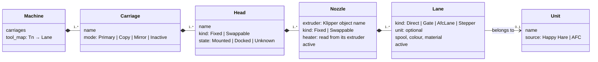
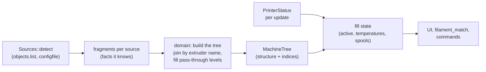

# Multi-tool printers (design draft)

Draft, 2026-11-10. Nothing of this is implemented yet. Object and field names were read from the sources' code
(main branches of that day), see [What each source reports](#what-each-source-reports).

## Goal

A printer can bring more than one filament to the bed in many ways: a filament changer (MMU) in front of one
extruder, several extruders into one nozzle, two nozzles on one head, heads to swap (tool changer), nozzles
to swap under one fixed head (Bondtech INDX), several carriages (IDEX), and combinations of these. FreakyMate shows and controls all of them with **one model**: a tree
that is assembled from what the detection finds. Screens, hints before a print (`filament_match`) and commands work
against the tree only and never ask which plugin is behind it.

Principles:

- **Every level is optional.** A level that the printer does not have is a pass-through: exactly one implicit node,
  never shown. A printer with one extruder and no MMU is a tree with one path and looks as it does today.
- **Every level can come in variants.** A head is fixed or swappable, a lane is a gate, an AFC lane, an extra
  extruder stepper or the direct feed. Variants are data on the node, not separate code paths in the UI.
- **Built from evidence.** Only what a source reports or the configuration states goes into the tree. Macros stay
  black boxes. Where a link cannot be detected, the tree leaves it open rather than guessing.
- **Built once, filled often.** The structure only changes with a Klipper restart, so it is assembled once at
  detection. Each status update only fills in the state (active, temperatures, spools) through indices prepared
  then.
- **Hand configuration last.** FreakyMate settings or FreakyMate macros that describe the machine are the last
  resort, or a way to individualise (experiments, new projects, special wishes); see
  [Overrides](#overrides-the-last-resort).

## The tree

From the bed inwards: a printer has carriages, a carriage holds heads, a head has nozzles, a nozzle is fed by lanes.

| Level    | Several of them when                                                       | Pass-through otherwise |
| -------- | -------------------------------------------------------------------------- | ---------------------- |
| Carriage | `dual_carriage` (IDEX; with `generic_cartesian` also more than two)        | one carriage           |
| Head     | a tool changer: `toolchanger` + `tool <name>`, `ktc` + `ktc_tool <name>`, AFC with an `AFC_Toolchanger` unit | one fixed head |
| Nozzle   | more than one Klipper `extruder*` object (each has its own heater), or swappable nozzles under one extruder (INDX) | `extruder` |
| Lane     | a filament changer (Happy Hare gates, AFC lanes) or extra `extruder_stepper`s feeding one nozzle | the direct feed |

**Where the swap happens is a property, not a level.** A tool changer swaps whole heads, each with its own
extruder. Bondtech INDX keeps one fixed head with the only extruder (motor, induction heater, IR sensor) and swaps
passive tools under it, each just a nozzle with its own filament path: one Klipper `extruder`, several nozzles, one
lane each. A filament changer swaps lanes. So any level can be swappable (`Mounted`/`Docked`), and a nozzle is the
physical outlet: usually one per Klipper extruder, with INDX several sharing it, of which one is mounted.

**Why the unit is not a level.** A Happy Hare v4 unit feeds one extruder, but an AFC unit (a Box Turtle, say) can
spread its lanes over several extruders. So the unit is a label on the lane (for grouping on screen and for its own
state such as the buffer), not a node between nozzle and lane.

**The Klipper extruder is the joint.** Not the nozzle: with INDX several nozzles share one extruder. Heater and
temperature belong to the extruder, the nozzle refers to it. Every source names the Klipper extruder it means,
though not always in its status:

- the tool changer's `tool <name>` reports `extruder`;
- KTC's `ktc_tool <name>` reports `heater_names` (an extruder's heater carries the extruder's name);
- a Happy Hare v4 unit has `extruder_name` in its configuration (`mmu_unit <name>`), and Happy Hare creates one
  object `mmu_extruder <extruder name>` per extruder it feeds; its status only names the extruder of the selected
  unit;
- an AFC lane reports its `extruder` (an `AFC_extruder` section), whose configuration names the Klipper extruder
  (`extruder_name`, default its own name);
- an `extruder_stepper` reports `motion_queue`, the extruder it is synced to right now.

Klipper's extruder object name is therefore the key that joins the fragments of different sources into one tree.
Since the structure is built once from `printer.objects.list` and `configfile.settings`, links that only the
configuration holds are fine. The one link nothing reports is which nozzle sits on which IDEX carriage (see
[open questions](#open-questions)).

## Slicer tools are a map, not a level

`Tn` from the slicer is logical: it says which filament, not where it comes from. Each source that knows the answer
contributes a map `Tn → lane`:

| Setup                         | Map comes from                                                        |
| ----------------------------- | --------------------------------------------------------------------- |
| Happy Hare                    | the tool-to-gate map (`mmu.ttg_map`), gates numbered across all units |
| AFC                           | each lane's `map` (`"T4"`); a tool changer's heads appear as lanes too |
| Tool changer without MMU      | the tool number of each head (`tool.tool_number`, KTC `ktc_tool.number`) → its one lane |
| INDX                          | `Tn` → passive tool n, each with its own lane                          |
| Several extruders, no changer | by convention `Tn` → `extruder`, `extruder1`, … in order (the macros `T0`… exist) |
| One extruder, no MMU          | `T0` → the only lane                                                   |

In the code `tool` already means `Tn` (`Lane::tool`, `ToolRequest::tool`); the physical tool is therefore called
**head** here, to keep the two apart.

Several sources can claim the same `Tn` (a tool changer numbers its heads, and a filament changer on one of them
maps tools to its gates). The deepest source that maps to a lane wins: the filament changer's map beats the tool
changer's numbers, which beat the convention. The code supports this: Happy Hare's `Tn` looks up `ttg_map`, selects
the gate and with it the unit, and never calls a tool changer or `ACTIVATE_EXTRUDER`; the swap of the head is left
to the user's macros. AFC's `Tn` picks the lane and, for a head, calls the tool changer itself.

## Active state

Each level has its own "active", read from the source that knows it:

- Carriage: the mode in `dual_carriage` (`carriage_0`/`carriage_1`, or `carriages` with `generic_cartesian`).
- Head: `toolchanger.tool` / `tool_number` (-1: none), KTC `ktc.active_tool_n` (-1 none, -2 unknown). AFC has no
  key for it; its loaded lane and `toolhead.extruder` say the same. Where tools have detection pins,
  `toolchanger.detected_tool` tells which head is really mounted.
- Nozzle: `toolhead.extruder`; with swappable nozzles under one extruder (INDX) the mounted one from the tool macro
  convention (`T<n>.active`).
- Lane: Happy Hare `mmu.gate`, AFC `AFC.current_load` (a lane name); with one lane, that lane.

The active path is the chain of active nodes. IDEX in copy or mirror mode is the one case with **two active
paths** at once; screens and hints must allow that (a list of active lanes, not one).

## Assembly

- Each source module contributes a **fragment** at detection: the nodes and links it knows, keyed by Klipper names
  (`klipper/`: nozzles, `extruder_stepper`s, carriages; `happy_hare/`: units and gates with their extruder;
  `afc/` (new): units, lanes, maybe heads; `toolchanger/` (new, covers viesturz and KTC-easy): heads with their
  extruder; `ktc/` (new, if worth it).
- `domain/machine_tree.rs` (new) joins the fragments: nodes that name the same extruder attach to it (one nozzle as a rule,
  several swappable nozzles with INDX), missing
  levels become pass-through nodes, the `Tn` map is chosen by the rule above. It knows no plugin, only fragments.
- The tree keeps, per node, where its state lives (object name and field), so filling it per update is a walk over
  prepared indices without searching by name.
- `domain/spools.rs` keeps `Lane` and gets its parent nozzle; `lanes()` becomes the lanes of the tree.
  `filament_match` compares `Tn` through the map; temperatures are compared at the extruder of the lane's nozzle.

## What each source reports

The fields a fragment needs; the full lists are in each project's `get_status()`.

| Source | Objects | Structure (read once) | State (per update) |
| --- | --- | --- | --- |
| Klipper | `toolhead`, `extruder*`, `extruder_stepper <name>`, `dual_carriage` | the extruders; the carriages | `toolhead.extruder`; per extruder `temperature`, `target`; `extruder_stepper.motion_queue`; carriage modes |
| Tool changer ([viesturz], [KTC-easy]) | `toolchanger`, `tool <name>` | `tool_names`, `tool_numbers`; per tool `tool_number`, `extruder`, `fan`, `gcode_*_offset` | `status` (`ready`, `changing`, `error`, …), `tool`, `tool_number`, `detected_tool`; viesturz only: per tool `detect_state` (`mounted`, `absent`, `unavailable`) and `heater` |
| KTC ([TypQxQ]) | `ktc`, `ktc_tool <name>`, `ktc_toolchanger <name>` | `tools`; per tool `number`, `heater_names`, `offset` | `active_tool`, `active_tool_n`, `state`; per tool `state`, `heater_state` |
| Happy Hare v4 | `mmu`, `mmu_machine`, `mmu_extruder <name>` | `mmu_machine.num_units`, `unit_<n>` with `first_gate`, `num_gates`, `display_name`; extruder per unit from `configfile` | `mmu.unit`, `tool`, `gate`, `ttg_map`, the `gate_*` arrays (across all units), `filament`, `print_state` |
| AFC | `AFC`, `AFC_lane <name>` / `AFC_stepper <name>`, `AFC_extruder <name>`, units such as `AFC_BoxTurtle <name>`, `AFC_Toolchanger <name>` | `AFC.units`, `lanes`, `extruders`; per lane `unit`, `extruder`, `map`; Klipper extruder per `AFC_extruder` from `configfile` | `AFC.current_load`, `current_state`; per lane `status`, `tool_loaded`, `spool_id`, `color`, `material`; per `AFC_extruder` `lane_loaded`, `on_shuttle`, `status` |

Setups built from macros only (INDX under Klipper, IDEX, several extruders) often follow the convention that
Mainsail's and Fluidd's tool buttons read: macros `T0` … `Tn` with the variables `active` (and often `color`). INDX
sets them from its own state (`save_variables`: `active_tool`, offsets), see
[indx-tc-macros.cfg](https://github.com/BondtechAB/INDX/blob/main/macros/indx-tc-macros.cfg). For FreakyMate this
is a convention source like `LOAD_FILAMENT`: what the macros report is shown, nothing more is assumed. Which
variables Mainsail reads exactly is still to be checked.

| Source | Objects | Structure (read once) | State (per update) |
| --- | --- | --- | --- |
| Tool macro convention | `gcode_macro T<n>` | the macros `T0` … `Tn` | per macro `active`, `color` if declared |

Notes:

- KTC-easy drops viesturz's per-tool `detect_state` and `heater`; both stay optional.
- An AFC lane reports an empty status until AFC has finished starting up.
- No Klipper object reports the offsets of a second nozzle. Only the tool changers do (`gcode_*_offset`, KTC
  `offset`); for IDEX and two nozzles on a head they live in macros.

[viesturz]: https://github.com/viesturz/klipper-toolchanger
[KTC-easy]: https://github.com/jwellman80/klipper-toolchanger-easy
[TypQxQ]: https://github.com/TypQxQ/KTC

## Commands

The tree only says what is there; commands stay with the source that carries them out.

- **Select `Tn`**: always the `Tn` command. Happy Hare, AFC and the tool changers register it, and printers with
  several extruders define it as a macro. FreakyMate never builds a tool change itself.
- **Lower-level actions** are offered only where a source supports them: select or load a gate (Happy Hare, AFC
  `CHANGE_TOOL LANE=`), pick up or drop a head (tool changer `SELECT_TOOL T=<n>` and `UNSELECT_TOOL`, the latter
  only if configured; KTC `KTC_T<n>`), set the carriage mode (`SET_DUAL_CARRIAGE`). Each one is a node action that the source provides, so the UI shows a button only on nodes
  that have one.
- What happens inside these commands (docking, offsets, purging, parking) is the macro's business and is not
  modelled.

## Overrides (the last resort)

When a link cannot be detected, or someone wants something special, two layers can help. Both are optional and
never needed for setups the detection covers:

1. **Settings in FreakyMate's configuration file**: name the missing links (this nozzle sits on that carriage),
   give lanes or heads display names, hide a level. They change the tree after the build, before the UI sees it.
2. **FreakyMate macros by convention**: if the printer defines, say, `FREAKYMATE_SELECT_TOOL` or
   `FREAKYMATE_PARK`, FreakyMate calls them instead of the source's command, as it already does with
   `LOAD_FILAMENT` (`macro_conventions.rs`). That is the hook for experiments and new hardware that no source knows
   yet. Names and parameters to be defined once a real case needs them.

## Order of work

1. **Tree with today's setups** (Happy Hare, single spool): refactoring only, screens unchanged. This proves the
   pass-through levels. Scope:
   - `domain/machine_tree.rs`: the types of the tree, the fragment of each source and the join, with pass-through
     carriage, head and nozzle; Happy Hare contributes units (`mmu_machine.unit_<n>`: `first_gate`, `num_gates`)
     and gates, Klipper the extruders, Spoolman the spools of the lanes.
   - The structure is built at detection and travels in the `Snapshot`; the state is filled per update in the core,
     so the presenter no longer derives the lanes again for each area.
   - `Lane` gets its place in the tree (unit, nozzle); `spools::lanes` and `filament_match` read from the tree. Gates
     are looked up by their index, not by their position in a list.
   - Tests: the tree of each `fake-moonraker` profile (basic, voron, happy-hare, ercf) equals today's lanes; the
     snapshot scenes stay pixel-identical.
2. **Tool changer** (viesturz and KTC-easy share the objects): heads with one lane each; Spoolman per head.
3. **Combinations**: AFC (with its tool changer unit) and Happy Hare v4 with several units; the unit as a label.
4. **IDEX**: carriages, copy and mirror as two active paths.
5. **Two nozzles on one head, several extruders into one nozzle**: rare, generic Klipper objects only.

Each step needs a matching profile in `fake-moonraker` (tool changer, AFC, IDEX) so that screens can be tested
without the hardware.

## Open questions

- **IDEX: which nozzle on which carriage.** Klipper's `[dual_carriage]` does not name an extruder; the link lives
  in the `T0`/`T1` macros. Options: the order convention (`extruder` on the first carriage), observing which
  carriage becomes primary when an extruder is activated, or a setting. Proposal: convention plus setting.
- **Happy Hare v4 together with a tool changer**: Happy Hare handles `Tn` and switches units, but nothing in its
  code or documentation swaps the head; that is up to the user's macros. Whether there is a common pattern for it
  (and which object then knows the head) needs a look at real configurations.
- **AFC with a tool changer**: AFC turns each head into a lane of the tool changer unit and calls `SELECT_TOOL`
  itself; the tool changer's own objects are there as well. Which of the two the tree trusts for the head is to be
  decided (proposal: `toolchanger` for the head, AFC for the lanes).
- **Spoolman per head without MMU**: only AFC keeps a spool per head (as a lane). Otherwise there is no common place;
  `SET_ACTIVE_SPOOL` in the tool change macros is a convention, not a fact. Possibly FreakyMate keeps the
  assignment itself.
- **Several extruders into one nozzle**: `extruder_stepper.motion_queue` shows which extruder a stepper is synced to
  right now, so the link is known while it is synced. Whether an unsynced stepper still counts as a lane of that
  nozzle (from its `extruder:` option in the configuration) is open.
